<div align="center">

# 🇪🇹 Addis Eats (Next.js)
### Enterprise Full-Stack Ethiopian Culinary Platform & Real-Time Kitchen Operations

An enterprise-grade, end-to-end food ordering, telemetry, and restaurant operations platform built with **Next.js 16 (App Router)**, **React 19**, and **Tailwind CSS v4**. Crafted specifically for the authentic culinary heritage of Addis Ababa, featuring dual-channel fulfillment (**City-wide Courier Delivery** and **Contactless Dine-in QR Ordering**), **Live Leaflet Route Tracking**, **SWR Real-Time Telemetry**, a **Staff Kitchen Queue**, and **Business Intelligence Analytics** powered by Recharts.

<br />

[](https://addis-eats-next-ivory.vercel.app/)
[](https://nextjs.org/)
[](https://react.dev/)
[](https://tailwindcss.com/)
[](https://leafletjs.com/)
[](https://recharts.org/)
[](https://swr.vercel.app/)
[](#-performance-benchmarks--lighthouse-audits)

<br />

<p align="center">
  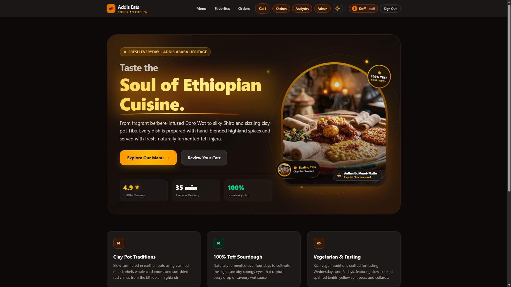
</p>

[🌐 Live Deployment](https://addis-eats-next-ivory.vercel.app/) • [📸 Visual Showcase](#-visual-feature-showcase) • [🗺️ Route Tracking](#2-real-time-order-telemetry--interactive-leaflet-route-map) • [🍳 Kitchen Staff Area](#3-kitchen-staff-operations-dashboard) • [📊 BI Analytics](#4-business-intelligence--analytics-reports) • [🛡️ Security Architecture](#-three-layer-defense-in-depth-security) • [⚡ Quickstart](#-getting-started)

</div>

---

## 📑 Table of Contents
- [Executive Overview](#-executive-overview)
- [Key Features & System Capabilities](#-key-features--system-capabilities)
- [Visual Feature Showcase](#-visual-feature-showcase)
  - [1. Storefront & Menu Catalog](#1-storefront--menu-catalog)
  - [2. Real-Time Order Telemetry & Interactive Leaflet Route Map](#2-real-time-order-telemetry--interactive-leaflet-route-map)
  - [3. Kitchen Staff Operations Dashboard](#3-kitchen-staff-operations-dashboard)
  - [4. Business Intelligence & Analytics Reports](#4-business-intelligence--analytics-reports)
  - [5. Administrative Menu CMS & Dynamic Stock Management](#5-administrative-menu-cms--dynamic-stock-management)
  - [6. Contactless Dine-In QR Generation & Table Management](#6-contactless-dine-in-qr-generation--table-management)
  - [7. Customer Order Manifest & RFC 4180 CSV Export](#7-customer-order-manifest--rfc-4180-csv-export)
  - [8. Day & Night Experience (Bespoke Dual Themes)](#8-day--night-experience-bespoke-dual-themes)
- [Technology Stack](#-technology-stack)
- [Hybrid Rendering & Data Lifecycle Matrix](#-hybrid-rendering--data-lifecycle-matrix)
- [Delivery vs. Dine-In Ordering Matrix](#-delivery-vs-dine-in-ordering-matrix)
- [Three-Layer Defense-in-Depth Security](#-three-layer-defense-in-depth-security)
- [Application Routes & Access Control](#-application-routes--access-control)
- [Real-Time Telemetry & Data Flow Architecture](#-real-time-telemetry--data-flow-architecture)
- [Project Architecture & File Tree](#-project-architecture--file-tree)
- [Performance Benchmarks & Lighthouse Audits](#-performance-benchmarks--lighthouse-audits)
- [Getting Started](#-getting-started)
- [Demo Credentials](#-demo-credentials)
- [Technical Documentation Index](#-technical-documentation-index)

---

## 🌟 Executive Overview

**Addis Eats** fuses the rich culinary heritage of Ethiopia with cutting-edge **Next.js 16 App Router** full-stack architecture. From slow-simmered highland wats seasoned with clarified *niter kibbeh* and sun-dried berbere to fresh 100% pure teff sourdough injera baked on clay mitads, the application serves two distinct user groups within a single cohesive system:

1. **Customers & Diners**: Discover authentic highland delicacies, filter dishes by meal periods and dietary restrictions (*Vegetarian / Fasting (Tsom)*, *Breakfast*, *Lunch*, *Dinner*), customize items with portion steppers, order for courier delivery with district-aware dispatch or scan tabletop QR codes for instant 0 ETB dine-in service, track couriers live on an animated Leaflet street map, and export order receipts to RFC 4180 CSV files.
2. **Kitchen Staff & Restaurant Operations**: A secure, role-guarded management portal featuring real-time kitchen ticket management (`/kitchen`), interactive business intelligence analytics (`/dashboard`) visualizing revenue by neighbourhood and daily volume via Recharts, full menu CMS with instant stock toggling (`/admin`), and dynamic QR generation for tabletop dining stations.

---

## 🚀 Key Features & System Capabilities

### 🍲 Customer Storefront & Ordering
* **Dynamic Menu Catalog**: High-resolution imagery, Amharic culinary naming, prices in Ethiopian Birr (`ETB`), category badges, and instant stock indicators.
* **Debounced Search & Categorization**: Client-side filtering powered by a 300ms debounce hook synchronized with category tabs (`All`, `Breakfast`, `Lunch`, `Dinner`).
* **Deep Dish Exploration**: Dedicated dynamic routes (`/menu/[id]`) with pre-rendered static params, detailed ingredient lists, and spice profiles.
* **Persistent Cart State**: Client-side shopping cart backed by React Context and `localStorage`, computing real-time subtotal breakdowns, taxes, and item counters.
* **Ethiopian District Delivery & Settlement**: Area-specific delivery fees across Bole, Kazanchis, Piassa, Arat Kilo, Sarbet, and CMC, with support for **Telebirr**, **CBE Birr**, and **Cash on Delivery**.
* **Favorites Gallery**: One-click heart toggling on dishes, preserved across sessions in a curated `/favorites` gallery.

### 🗺️ Live Telemetry & Interactive Leaflet Route Map
* **Sub-Second SWR Telemetry**: Real-time polling every 5,000ms against `/api/orders/[id]` without screen flicker; automatically terminates polling once an order reaches a terminal state (`Delivered` or `Cancelled`).
* **Zero-Spinner Server Seeding**: Initial server hydration ensures customers never experience layout shifts or loading spinners upon arrival at `/track/[id]`.
* **Animated OpenStreetMap Route**: Dynamic Leaflet map tracing the courier's path from **Bole, Addis Ababa** to the customer's delivery neighbourhood (Kazanchis, Piassa, etc.) with animated waypoints and sector markers.

### 🏢 Operations, Kitchen Queue & Business Intelligence
* **Live Kitchen Queue (`/kitchen`)**: Real-time ticket board allowing kitchen staff to transition orders through a 4-stage lifecycle (`Preparing` &rarr; `Cooking` &rarr; `Ready` &rarr; `Delivered`) via Server Actions (`updateOrderStatus`).
* **Business Intelligence Dashboard (`/dashboard`)**: Interactive analytics suite with Recharts bar charts showing revenue breakdown by Addis Ababa district, bezier volume curve charts over time, and KPI metrics.
* **Menu Catalog CMS (`/admin`)**: Add, edit, or remove dishes, update pricing, and toggle instant stock status (`Available` vs `Sold Out`) without server downtime.
* **Table QR Code Generation Engine**: Provision unique dining stations (Window Booth, Main Hall, Garden Patio, VIP Lounge), synthesize high-resolution QR codes, download printable PNGs, and provide direct table-locked customer URLs (`/menu?table=X`).
* **RFC 4180 CSV Data Export**: Instant download of client and staff order manifests formatted to standard RFC 4180 specifications.

---

## 📸 Visual Feature Showcase

> High-fidelity production previews highlighting the core experiences of Addis Eats.

### 1. Storefront & Menu Catalog
*Discover authentic Ethiopian highland specialties with instant category filters, real-time debounced search, and live availability states.*

<p align="center">
  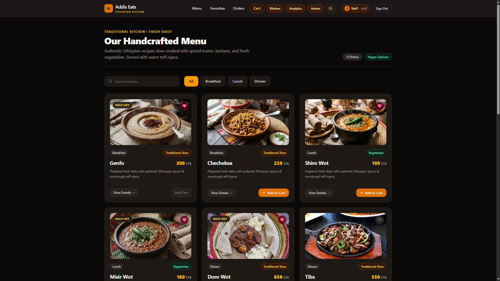
</p>

---

### 2. Real-Time Order Telemetry & Interactive Leaflet Route Map
*Live 4-stage preparation telemetry powered by SWR polling, coupled with an interactive Leaflet route map showing courier transit across the Addis Ababa street grid.*

<p align="center">
  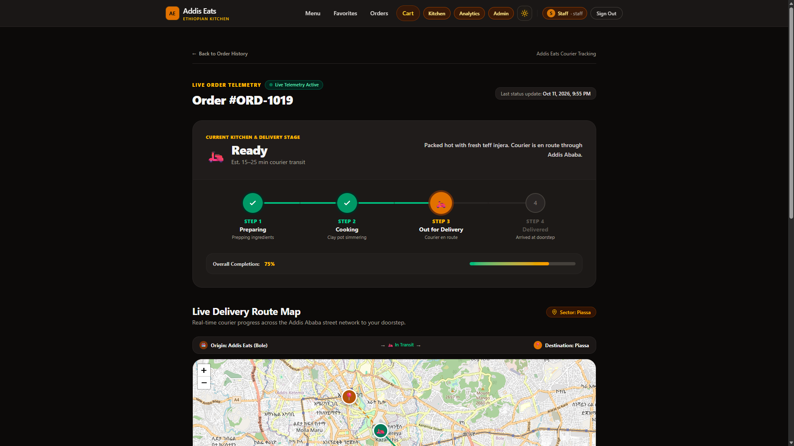
</p>

#### Leaflet Route Map Close-Up
*Street-level geospatial route visualization from Addis Eats kitchen origin in Bole through Kazanchis to Piassa.*

<p align="center">
  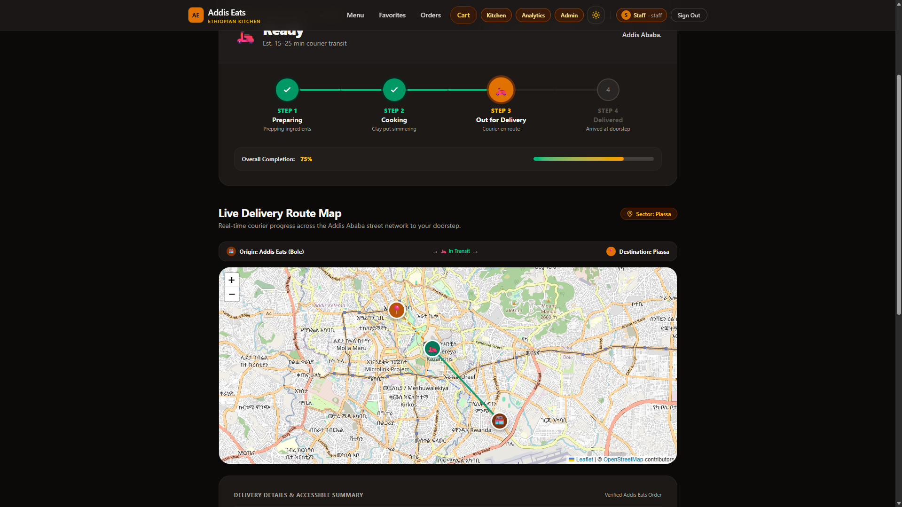
</p>

---

### 3. Kitchen Staff Operations Dashboard
*Real-time incoming customer order queue with instant status advancement dropdowns, destination badges, and ticket inspection.*

<p align="center">
  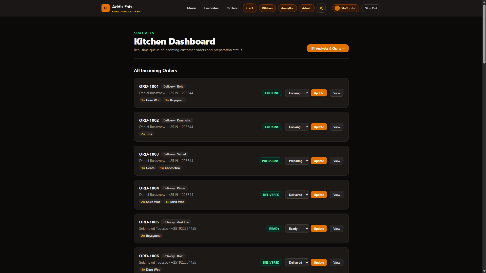
</p>

---

### 4. Business Intelligence & Analytics Reports
*Comprehensive staff business intelligence powered by Recharts, offering actionable insights into sales, order frequency, and popular delivery sectors.*

#### Revenue by Neighbourhood Breakdown
*Cumulative sales distribution across Bole, Kazanchis, Sarbet, Piassa, Arat Kilo, and on-premise dining tables.*

<p align="center">
  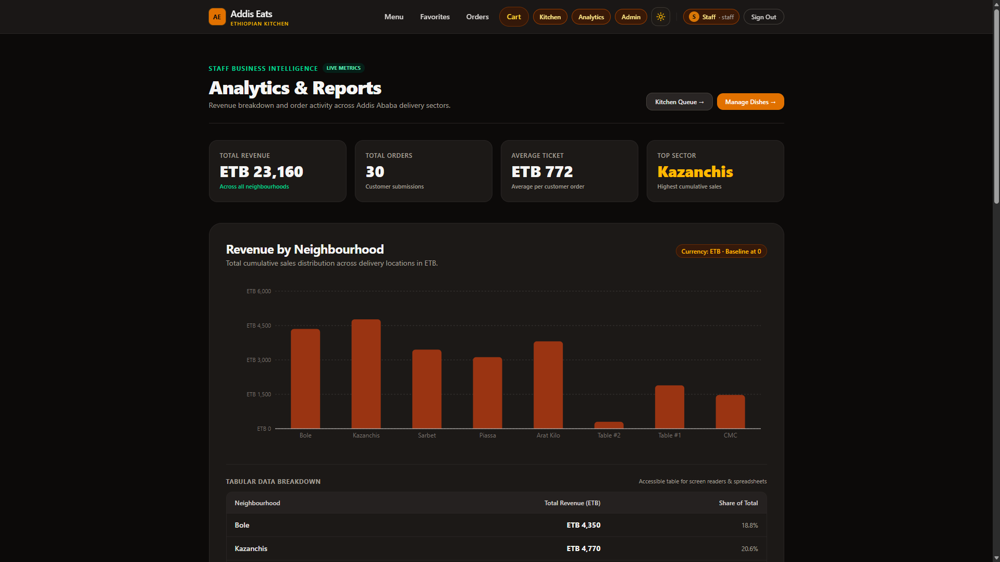
</p>

<br />

#### Orders Over Time Trend Analysis
*Interactive timeline displaying daily incoming order volumes, peak ordering days, and accessible tabular summaries.*

<p align="center">
  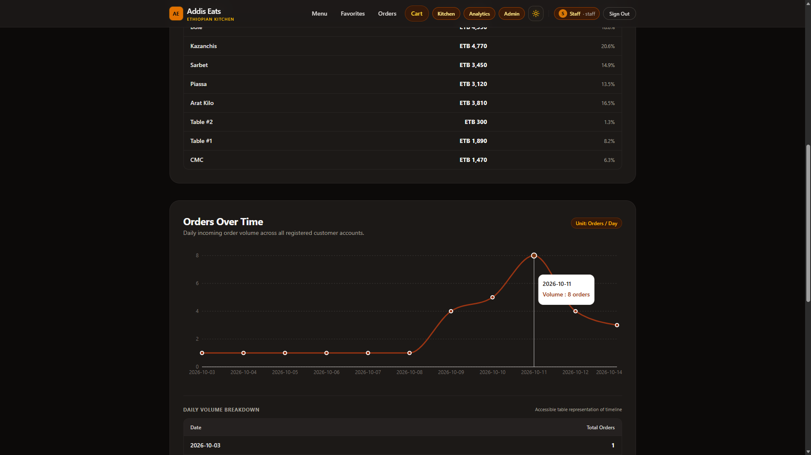
</p>

---

### 5. Administrative Menu CMS & Dynamic Stock Management
*Full back-office control: update catalog dishes, modify pricing, toggle stock availability (`Available` / `Sold Out`), and monitor catalog health.*

<p align="center">
  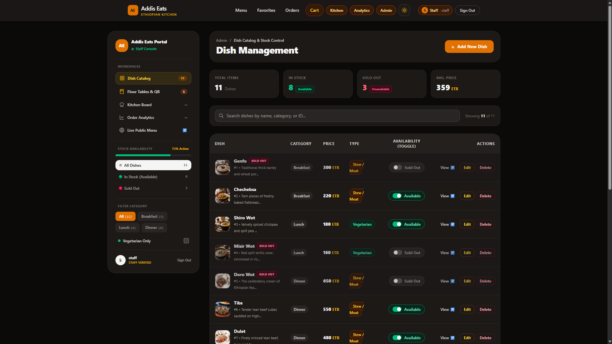
</p>

---

### 6. Contactless Dine-In QR Generation & Table Management
*Provision dining tables across Window Booths, Main Hall, Garden Patio, and VIP Lounge. Dynamic in-browser QR generation allows customers to scan and order with 0 ETB service fee.*

<p align="center">
  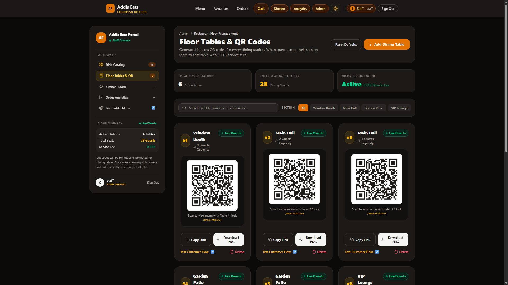
</p>

---

### 7. Customer Order Manifest & RFC 4180 CSV Export
*Customer dashboard displaying order histories, real-time status badges, table numbers, and single-click RFC 4180 CSV export.*

<p align="center">
  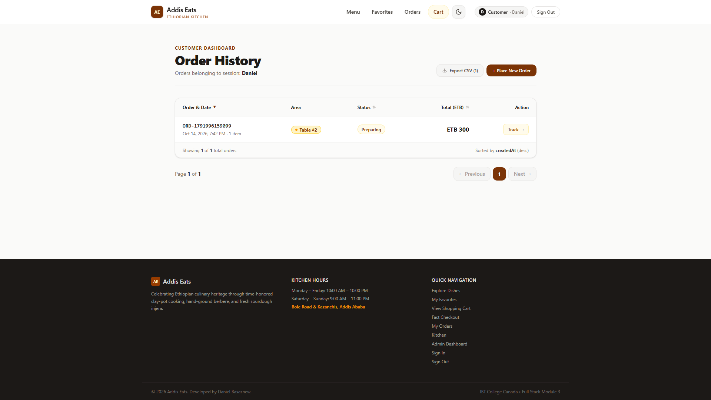
</p>

---

### 8. Day & Night Experience (Bespoke Dual Themes)
*Seamless theme switching between sleek Obsidian Dark Mode and warm, heritage-inspired Ivory Light Mode.*

#### Daytime Heritage Light Theme — Hero & Catalog
<p align="center">
  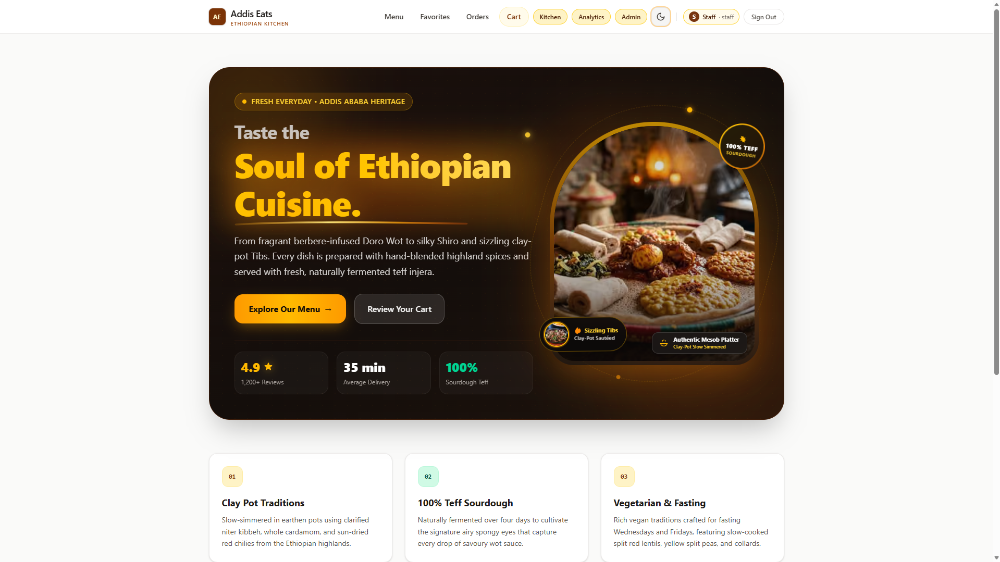
  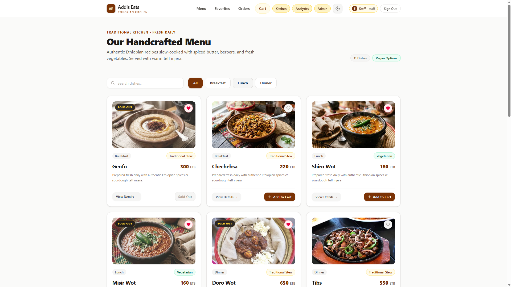
</p>

---

## 🛠️ Technology Stack

| Layer | Technology | Version | Purpose / Architecture Notes |
| :--- | :--- | :---: | :--- |
| **Framework** | [Next.js (App Router)](https://nextjs.org/) | `16.3.5` | Hybrid rendering (Static, ISR, SSG, Dynamic), Server Actions, Edge Middleware |
| **UI Library** | [React](https://react.dev/) | `19.2.8` | Server Components, Suspense, client state hooks, concurrent features |
| **Styling & Design** | [Tailwind CSS](https://tailwindcss.com/) | `v4.0` | Next-gen CSS engine, CSS variable theme tokens, responsive layouts |
| **Interactive Maps** | [Leaflet](https://leafletjs.com/) / [React Leaflet](https://react-leaflet.js.org/) | `1.9.4` / `5.0.0` | Client-only SSR-safe dynamic map boundary, street waypoints, animated marker |
| **Analytics & Charts** | [Recharts](https://recharts.org/) | `3.10.1` | Responsive Bar & Line charts, custom SVG tooltips, bezier curve calculations |
| **Real-Time Polling** | [SWR](https://swr.vercel.app/) | `2.5.1` | Lightweight client telemetry polling (5s interval) with terminal auto-close |
| **Data Validation** | [Zod](https://zod.dev/) | `4.6.5` | Strong runtime schema validation for checkout forms and session payloads |
| **QR Code Engine** | [node-qrcode](https://github.com/soldair/node-qrcode) | `1.5.4` | In-browser dynamic QR synthesis and downloadable high-res PNG generation |
| **Deployment & Edge**| [Vercel](https://vercel.com/) | Global Edge | Ephemeral serverless execution with cookie hydration persistence |

---

## ⚡ Hybrid Rendering & Data Lifecycle Matrix

Addis Eats implements an optimal hybrid rendering strategy designed for lightning-fast First Contentful Paint (FCP) and real-time operational reactivity:

| Scope / Route | Rendering Strategy | Symbol | Invalidation & Lifecycle | Purpose |
| :--- | :--- | :---: | :--- | :--- |
| **Storefront (`/`)** | Static Pre-rendering | `○` | Built at compile time | Ultra-fast landing page delivery with zero server latency |
| **Menu Catalog (`/menu`)** | Incremental Static Regeneration | `ISR` | Hourly (`revalidate = 3600`) | Cached catalog with on-demand background regeneration |
| **Dish Details (`/menu/[id]`)** | Static Site Generation | `●` | `generateStaticParams` | Pre-renders individual dish pages for all 11+ catalog dishes |
| **Order History (`/orders`)** | Server-Side Dynamic | `ƒ` | On-demand (`force-dynamic`) | User-scoped order manifest hydrated from session cookie |
| **Order Telemetry (`/track/[id]`)**| Hybrid Dynamic + SWR | `ƒ` | Server seeded + 5s polling | Zero-spinner initial paint, client-side Leaflet hydration, 5s telemetry |
| **Kitchen Queue (`/kitchen`)** | Dynamic Server Action | `ƒ` | Immediate (`revalidatePath`) | Real-time queue for staff with instant server state mutation |
| **Analytics Dashboard (`/dashboard`)**| Dynamic Server Action | `ƒ` | On-demand (`force-dynamic`) | Computes real-time district revenues and order volume metrics |
| **Order Bag (`/cart`)** | Client State | Client | React Context + `localStorage` | Instant interactive cart operations with zero network roundtrips |

---

## 🔄 Delivery vs. Dine-In Ordering Matrix

Addis Eats seamlessly caters to both on-premise diners and city-wide courier delivery orders:

| Dimension | Courier Delivery Order 🛵 | Dine-In Table QR Order 🍽️ |
| :--- | :--- | :--- |
| **Discovery Route** | Standard `/menu` catalog | Scanned Tabletop QR Code (`/menu?table={id}`) |
| **Table Context** | Delivery address form required | Auto-locked via `TableBanner` & URL parameter |
| **Destination** | Addis Ababa District (Bole, Kazanchis, etc.) | Specific Venue Station (e.g. *Window Booth #1*) |
| **Delivery Service Fee**| Calculated by area (50–90 ETB) | **0 ETB (Free)** |
| **Live Telemetry** | Animated Leaflet courier street route | Kitchen preparation stage progress stepper |
| **Payment Options** | Telebirr, CBE Birr, Cash on Delivery | Telebirr, CBE Birr, Cash at Table |
| **Kitchen Manifest** | Marked with `Delivery · Bole` badge | Marked with `Table #1` station badge |

---

## 🛡️ Three-Layer Defense-in-Depth Security

Addis Eats enforces an enterprise three-layer security model to protect customer data and administrative controls:

```
[ Incoming Request ]
         │
         ▼
┌────────────────────────────────────────────────────────┐
│  Layer 1: Edge Perimeter Middleware (middleware.js)    │
│  - Intercepts /kitchen, /orders, /track, /checkout     │
│  - Verifies presence of signed session cookie          │
│  - Sanitizes redirect targets against Open Redirects   │
└────────────────────────┬───────────────────────────────┘
                         │ Valid
                         ▼
┌────────────────────────────────────────────────────────┐
│  Layer 2: Server Page Guards (page.js)                 │
│  - Calls `await getSession()` inside Server Component  │
│  - Enforces role requirements ('staff' vs 'customer')  │
│  - Blocks IDOR: checks if order.userId === session.id  │
└────────────────────────┬───────────────────────────────┘
                         │ Authorized
                         ▼
┌────────────────────────────────────────────────────────┐
│  Layer 3: Mutation & API Guards (actions.js, /api/*)   │
│  - Server Actions independently re-verify session role │
│  - Validates Zod schema inputs before mutating state   │
│  - Returns structured authorization errors on bypass   │
└────────────────────────────────────────────────────────┘
```

### OWASP Mitigations
* **IDOR Prevention**: Prevents customer resource enumeration; viewing an order belonging to another customer returns an HTTP 404 (`notFound()`) rather than 403, completely masking record existence.
* **Open Redirect Defense**: The `getSafeNext(next)` sanitizer strictly inspects redirect destinations, rejecting `//`, `\`, and external protocols to default safely to `/`.
* **Tamper-Proof Session Cookie**: Cryptographically signed HMAC-SHA-256 session cookie configured with `httpOnly: true`, `secure: true`, and `sameSite: 'lax'`.

---

## 🗺️ Application Routes & Access Control

| Route | Access Level | Rendering | Description |
| :--- | :--- | :---: | :--- |
| `/` | Public | `○ Static` | Brand landing page, cultural story highlights, and curated dishes |
| `/menu` | Public | `ISR (1h)` | Full dish catalog with debounced search and category filter bar |
| `/menu/[id]` | Public | `● SSG` | Deep dish exploration with ingredient lists and portion steppers |
| `/cart` | Public | Client | Interactive shopping bag with subtotal computation |
| `/checkout` | Authenticated | `ƒ Dynamic` | District delivery calculation and Ethiopian payment gateways |
| `/orders` | Authenticated | `ƒ Dynamic` | User-scoped past order receipts and RFC 4180 CSV export |
| `/track/[id]` | Owner / Staff | `ƒ Dynamic` | Live SWR preparation tracking and Leaflet route map |
| `/favorites` | Public | Client | Curated collection of user-favorited dishes |
| `/kitchen` | Staff Only | `ƒ Dynamic` | Live kitchen ticket queue with 4-stage lifecycle controls |
| `/dashboard` | Staff Only | `ƒ Dynamic` | Business intelligence analytics, Recharts graphs, and revenue reports |
| `/admin` | Staff Only | `ƒ Dynamic` | Menu CMS, dish stock toggles, and Table QR generation suite |
| `/signin` | Public | Client | Unified authentication screen with 1-click customer & staff presets |
| `/signout` | Authenticated | Action | Destroys session cookie and safely redirects to home |

---

## 🔄 Real-Time Telemetry & Data Flow Architecture

The diagram below illustrates the end-to-end data lifecycle from order placement to staff fulfillment and customer map tracking:

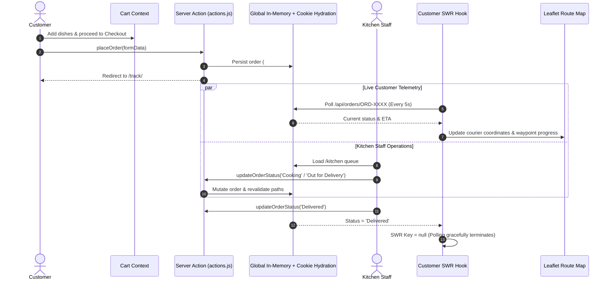

---

## 📁 Project Architecture & File Tree

```
addis-eats-next/
├── public/
│   ├── dishes.json                   # Base Ethiopian dish catalog data
│   ├── orders.json                   # Initial seeded orders
│   ├── tables.json                   # Base floor tables configuration
│   ├── for-readme/                   # High-fidelity project screenshots & walkthroughs
│   ├── for-documentation/            # Lighthouse audit evidence reports
│   └── images/                       # Dish photography & culinary assets
├── src/
│   ├── app/                          # Next.js 16 App Router hierarchy
│   │   ├── actions.js                # Server Actions (order mutations, dish CMS, auth)
│   │   ├── globals.css               # Tailwind CSS v4 directives & theme variables
│   │   ├── layout.js                 # Root layout with theme provider & navigation
│   │   ├── page.js                   # Pre-rendered marketing storefront
│   │   ├── admin/                    # Admin portal & dish management CMS
│   │   │   ├── page.js               # Staff-only dish catalog & stock controller
│   │   │   ├── loading.js            # Admin skeleton state
│   │   │   └── error.js              # Admin boundary error handler
│   │   ├── api/                      # Next.js Route Handlers
│   │   │   ├── dishes/               # Public dishes endpoint
│   │   │   └── orders/[id]/          # SWR order telemetry polling endpoint
│   │   ├── cart/                     # Shopping bag page
│   │   ├── checkout/                 # Form validation & payment processing
│   │   ├── dashboard/                # Staff business intelligence & analytics
│   │   │   ├── page.js               # Revenue calculations & KPI cards
│   │   │   ├── RevenueChart.jsx      # Recharts district revenue bar chart
│   │   │   └── OrdersChart.jsx       # Recharts order volume line graph
│   │   ├── favorites/                # Customer saved favorites
│   │   ├── kitchen/                  # Staff live order fulfillment board
│   │   ├── menu/                     # Catalog & dish detail pages
│   │   │   ├── page.js               # ISR menu catalog with debounced search
│   │   │   └── [id]/page.js          # SSG individual dish detail view
│   │   ├── orders/                   # Customer order manifest & CSV export
│   │   ├── signin/                   # Authentication screen with 1-click presets
│   │   ├── signout/                  # Session teardown route
│   │   └── track/[id]/               # Live order telemetry & Leaflet map
│   │       ├── page.js               # Server-seeded SSR tracking page
│   │       ├── TrackInteractiveView.jsx # SWR polling & progress stepper
│   │       ├── MapPanel.jsx          # SSR-safe dynamic Leaflet map container
│   │       └── LeafletMap.jsx        # Interactive OpenStreetMap route renderer
│   ├── components/                   # Reusable UI component library
│   │   ├── AddToCartButton.jsx       # Interactive quantity stepper & bag adder
│   │   ├── AdminDishManager.jsx      # Complete CMS dish table & stock toggles
│   │   ├── AdminTableManager.jsx     # Table registry & dynamic QR synthesizer
│   │   ├── CartProvider.jsx          # Shopping bag React Context provider
│   │   ├── CategoryBar.jsx           # Meal period category selector
│   │   ├── CheckoutForm.jsx          # Validated checkout & gateway selector
│   │   ├── CsvExportButton.jsx       # RFC 4180 CSV export utility button
│   │   ├── DishCard.jsx              # Responsive dish card with image optimization
│   │   ├── FavoriteButton.jsx        # Heart bookmark toggle button
│   │   ├── Navbar.jsx                # Responsive header with session badges
│   │   ├── OrderStatus.jsx           # SWR polling badge component
│   │   ├── TableBanner.jsx           # Active dine-in table lock banner
│   │   ├── ThemeProvider.jsx         # Dual theme provider (Dark / Light)
│   │   └── ThemeToggle.jsx           # Smooth SVG theme switcher
│   └── lib/                          # Core business logic & utility modules
│       ├── csv.js                    # RFC 4180 CSV serializer
│       ├── dishes.js                 # Dish data layer & stock availability resolver
│       ├── format.js                 # ETB currency & Addis Ababa time formatters
│       ├── orders.js                 # Order state layer & serverless cookie hydration
│       ├── session.js                # HMAC-SHA-256 session cookie manager
│       └── tables.js                 # Table registry data access layer
├── middleware.js                     # Edge Perimeter authentication guard
├── AUTH.md                           # Detailed security & authentication documentation
├── DATA.md                           # Data fetching, caching & serverless persistence
├── PERF.md                           # Performance audit report & Lighthouse metrics
├── package.json
└── next.config.mjs
```

---

## 📊 Performance Benchmarks & Lighthouse Audits

The production build on Vercel was evaluated using Chrome DevTools Lighthouse 13.5 across both Desktop and Mobile viewports under unthrottled and simulated Slow 4G conditions:

| Audit Target | Viewport | Network Profile | Performance | Accessibility | Best Practices | SEO | Status |
| :--- | :--- | :--- | :---: | :---: | :---: | :---: | :---: |
| **Storefront (`/`)** | Desktop | No Throttling | **100** | **94** | **100** | **100** | 🟢 Optimal |
| **Storefront (`/`)** | Desktop | Simulated Slow 4G | **98** | **94** | **100** | **100** | 🟢 Optimal |
| **Storefront (`/`)** | Mobile | No Throttling | **99** | **94** | **100** | **100** | 🟢 Optimal |
| **Storefront (`/`)** | Mobile | Simulated Slow 4G | **99** | **94** | **100** | **100** | 🟢 Optimal |
| **Menu Catalog (`/menu`)**| Desktop | No Throttling | **100** | **95** | **100** | **100** | 🟢 Optimal |
| **Menu Catalog (`/menu`)**| Desktop | Simulated Slow 4G | **96** | **95** | **100** | **100** | 🟢 Optimal |
| **Menu Catalog (`/menu`)**| Mobile | No Throttling | **100** | **95** | **100** | **100** | 🟢 Optimal |
| **Menu Catalog (`/menu`)**| Mobile | Simulated Slow 4G | **99** | **95** | **100** | **100** | 🟢 Optimal |

### Key Optimizations Applied:
1. **Responsive `next/image` Transcoding**: Automatically converts heavy JPGs to modern WebP/AVIF formats, cutting total image transfer payload from **4.5 MB to 513 kB (-88.6%)**.
2. **Above-the-Fold Preloading**: Priority preloading on the hero Mesob image reduces Largest Contentful Paint (LCP) from **12.3s to 1.2s–2.4s**.
3. **Zero Cumulative Layout Shift (`CLS = 0.000`)**: Explicit dimensional aspect ratios reserve space prior to asset load.
4. **Dynamic SSR Boundary for Leaflet**: OpenStreetMap Leaflet module is wrapped in `next/dynamic(..., { ssr: false })` with a fixed skeleton container, preventing SSR window crashes and client tile layout jumps.

*Comprehensive audit logs and screenshots are available in [PERF.md](PERF.md) and [`public/for-documentation/`](./public/for-documentation/).*

---

## ⚡ Getting Started

### Prerequisites
* **Node.js**: `v18.18+` or `v20.0+`
* **npm**: `v9.0+`

### 1. Clone the Repository
```bash
git clone https://github.com/DanielBasaznew/addis-eats-next.git
cd addis-eats-next
```

### 2. Install Dependencies
```bash
npm install
```

### 3. Environment Configuration
Create a local environment file based on the provided template:
```bash
cp .env.example .env.local
```
*(Optional)* Adjust variables if needed:
```env
SESSION_SECRET="your-secure-session-hmac-secret-at-least-32-chars-long"
STAFF_ACCESS_CODE="addis-kitchen-2026"
```

### 4. Run the Development Server
```bash
npm run dev
```
Open your browser at [http://localhost:3000](http://localhost:3000) to start exploring.

### 5. Code Quality & Linting
```bash
npm run lint
```

### 6. Build for Production
```bash
npm run build
npm run start
```

---

## 🔑 Demo Credentials

To evaluate all features without manual registration, convenient one-click presets are provided directly on the sign-in screen:

| Role | Username / Identifier | Access Passcode | Purpose & Permissions |
| :--- | :--- | :--- | :--- |
| **Customer** | `daniel` | *(None required)* | Tracks order `#ORD-1001`, reviews past order manifests, places new delivery or dine-in orders. |
| **Kitchen Staff** | `staff` | `addis-kitchen-2026` | Accesses the live Kitchen Queue (`/kitchen`), Business Intelligence (`/dashboard`), and Admin Menu/QR CMS (`/admin`). |

---

## 📚 Technical Documentation Index

For deep architectural analyses aligned with the CodeOps Module 3 engineering standards, refer to the following documents:

* **[AUTH.md](AUTH.md) — Authentication & Access Control**
  * Stateless HMAC-SHA-256 session cookie lifecycle and 7-day expiration.
  * Three-layer defense matrix: Edge Middleware (`middleware.js`), Page Guards (`page.js`), and Server Action/API guards.
  * OWASP verification: Defense proofs against IDOR, unauthenticated mutations, and open redirect phishing.
* **[DATA.md](DATA.md) — Data Fetching & Storage Lifecycle**
  * Server-First boundaries vs. client-side SWR reactivity.
  * Seeding initial server state to eliminate arrival loading spinners and layout shifts.
  * Vercel serverless persistence mechanism: In-memory store, `/tmp` fallback, and Day 45 cookie hydration pattern.
* **[PERF.md](PERF.md) — Lighthouse Audits & Benchmarks**
  * Real Lighthouse production audit scores (**96–100 Performance, 94–95 Accessibility, 100 Best Practices, 100 SEO**).
  * Desktop vs. Mobile benchmarks across No Throttling and Slow 4G conditions.
  * Core Web Vitals optimization: 88.6% image transfer payload reduction and 0.000 CLS.
  * Evidence screenshots cataloged in [`public/for-documentation/`](./public/for-documentation/).

---

<div align="center">

Crafted with ❤️ for the vibrant flavors of **Addis Ababa** • Built with **Next.js 16 & React 19**

**[Daniel Basaznew](https://github.com/DanielBasaznew)** • IBT College Canada • Full Stack Module 3

</div>
